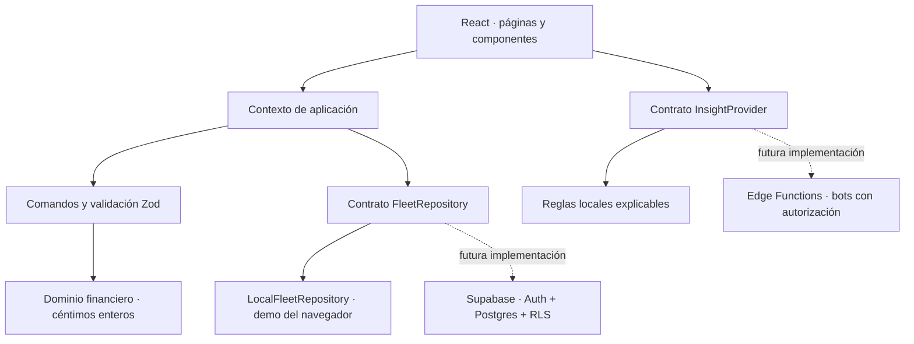

# Arquitectura de TruckControl AI

## Capas

- `src/domain`: modelos, validación de relaciones, comandos, cálculos y contrato de análisis. Sin React ni llamadas a servicios.
- `src/data`: semilla ficticia y adaptador local del contrato de repositorio.
- `src/app`: carga, estado de la flota, serialización del guardado y navegación con hash. Los enlaces profundos no requieren reescrituras en el servidor.
- `src/components`, `src/pages`: interfaz adaptable, formularios y presentación. El estado visual solo cambia después de guardar correctamente.
- `src/integrations/supabase`: fábrica de cliente opcional y contrato de tablas. No se instancia durante la demo. Los tipos son un contrato inicial mantenido a mano, no una extracción de un proyecto remoto.
- `supabase/migrations`: esquema inicial creado con la CLI y probado con PostgreSQL embebido.

## Estado y persistencia

`FleetRepository` ofrece `load`, `save` y `reset`. La implementación local guarda un documento versionado en `truckcontrol.demo.v1`. Zod comprueba los registros al cargar y guardar; la validación de dominio comprueba identificadores únicos, matrículas normalizadas, asignaciones únicas y referencias a camiones existentes.

Un conductor asignado no puede borrarse ni ponerse de permiso. Un camión con movimientos no puede eliminarse. La demo permite editar y borrar movimientos explícitamente; no implementa todavía un libro contable inmutable.

Si los datos guardados están dañados o tienen una versión desconocida, la carga no los sobrescribe. Se muestra una recuperación mediante restablecimiento explícito. Si el navegador rechaza un guardado, la interfaz conserva el estado anterior y muestra el error. Hay una exclusión de guardados simultáneos dentro de una pestaña. **No hay bloqueo o reconciliación entre varias pestañas**; usar una sola pestaña de edición durante esta fase.

El documento completo es suficiente para 50 camiones y la demo de 2.100 movimientos. Para producción se debe sustituir por consultas paginadas y escrituras de entidad, con control de concurrencia en servidor. No se debe replicar el guardado completo del snapshot en Supabase.

## Economía y fechas

Los valores monetarios son enteros seguros de céntimos; los campos de entrada aceptan coma o punto decimal y un máximo de dos decimales, sin separadores de miles. Las fechas de negocio son `YYYY-MM-DD`, validadas como fechas reales. Los filtros mensuales no dependen de conversiones de zona horaria.

El beneficio usa todos los movimientos del periodo, incluidos los pendientes. El margen es nulo cuando no existen ingresos, y el coste por km es nulo cuando no hay km. Los km solo se aceptan en ingresos, para evitar duplicarlos al cargar gastos. Los importes principales del resumen se presentan redondeados a euros; fichas, movimientos e informes económicos conservan dos decimales.

## Supabase

El esquema usa `organizations`, `drivers`, `trucks` y `finance_entries`. Todas las tablas expuestas tienen RLS. La Fase 1 define acceso por propietario de organización, mediante `auth.uid()` y `owner_id`; no utiliza metadatos modificables por el usuario para autorizar. Los roles de equipo y miembros de organización son trabajo futuro.

Las referencias compuestas `(organization_id, truck_id)` y `(organization_id, driver_id)` impiden cruzar organizaciones incluso cuando se omite un filtro del cliente. Hay índices para propietario, organización/estado, organización/fecha y organización/camión/fecha. Los importes usan `bigint` con un rango compatible con los enteros seguros de JavaScript. Los triggers de asignación son `security invoker`, en un esquema privado, con `search_path` fijo.

La migración se valida en PGlite con roles `anon` y `authenticated` y una función `auth.uid()` de prueba. Esto comprueba SQL, restricciones y políticas; no sustituye una prueba de integración en Supabase real con PostgREST, Auth, asesores y sesiones. Antes de activar el adaptador remoto hay que:

1. Elegir el proyecto de Supabase de destino y revisar su esquema y configuración de Data API.
2. Aplicar y verificar la migración en desarrollo; ejecutar los asesores de seguridad y rendimiento.
3. Regenerar los tipos desde ese proyecto, implementar autenticación y un repositorio remoto por entidad.
4. Probar las políticas con sesiones reales de diferentes propietarios y añadir roles de equipo.
5. Definir concurrencia, auditoría, copias de seguridad y sincronización antes de incorporar información real.

La fábrica solo admite claves `sb_publishable_`. Las claves secretas nunca pertenecen a variables `VITE_` ni al código público.

## Bots IA

`InsightProvider` separa recomendaciones y UI. `LocalInsightProvider` aplica reglas de vencimientos, pérdidas y cobros; ninguna regla modifica datos. Los futuros proveedores remotos deben ejecutarse detrás de autenticación, con acceso de lectura acotado a la organización, salidas validadas y un registro de ejecución. Cualquier acción propuesta debe pasar por el servicio de comandos con permisos y confirmación humana antes de escribir. No se incluyen bots autónomos activos ni claves de modelos.

## Distribución

Vite construye una SPA estática. `vite-plugin-pwa` genera manifiesto y service worker con caché de HTML, JS, CSS, iconos y fuentes locales. La actualización se propone al usuario para que guarde sus formularios primero. Sites aloja la demo privada mediante `.openai/hosting.json`; el código principal permanece en el repositorio GitHub del usuario.

La PWA comparte interfaz entre escritorio y móvil, pero cada navegador mantiene sus datos. Un envoltorio nativo Tauri/Capacitor, firma y distribución en tiendas son pasos posteriores si se requieren instaladores o integraciones con el dispositivo.
